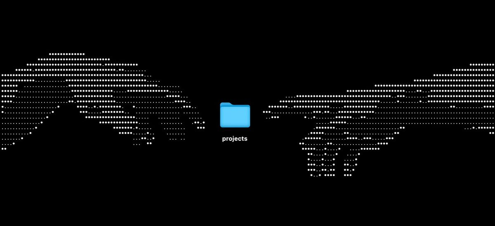

 <p align="center">
  
</p>

## 👋 Sobre mim

Desenvolvedor(a) full stack apaixonado(a) por construir coisas úteis, aprender rápido e deixar o código limpo. Gosto de transformar ideias em produtos que funcionam de verdade.

## 🖥️ Sistema

```text
seu_nome@github ────────────────────────
. OS .................... Windows 11, Linux
. Role .................. Desenvolvedor Full Stack
. Uptime ................ 2 anos programando
. IDE ................... VS Code

. Languages.Programming . JavaScript, Python
. Languages.Computer .... HTML, CSS, JSON
. Languages.Real ........ Português

. Skills.Frontend ....... React, Tailwind, TypeScript
. Skills.Backend ........ Node.js, FastAPI, REST
. Skills.Tools .......... Git, Docker, Linux
. Hobbies ............... Games, Música, Hardware
```

## 🛠️ Skills


## 📫 Contato

- ✉️ Email: thighito@gmail.com
- 💼 LinkedIn: linkedin.com/in/seu-usuario
- 💬 Discord: seu-usuario

## 📊 GitHub Stats


